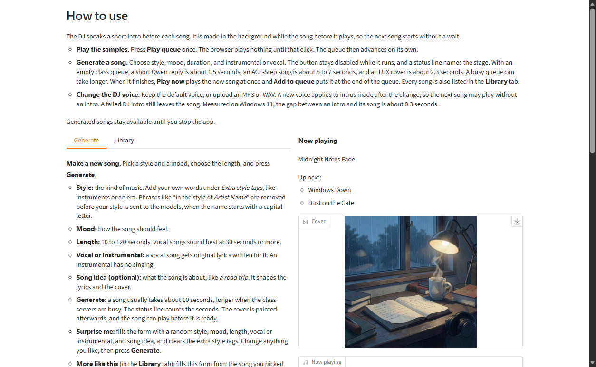
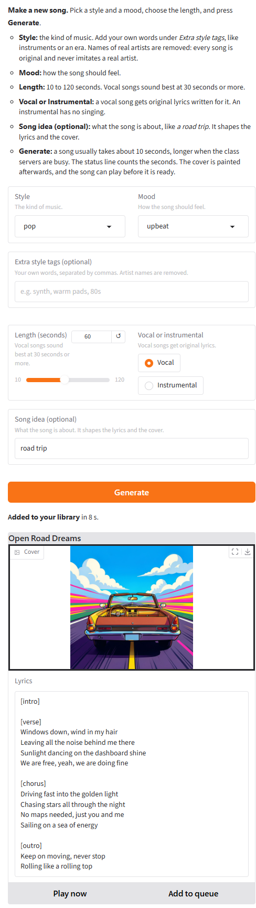
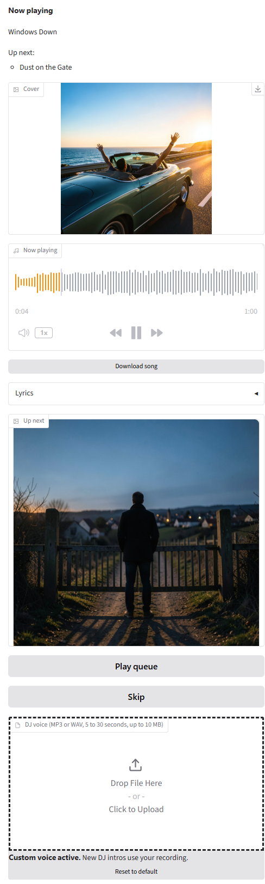
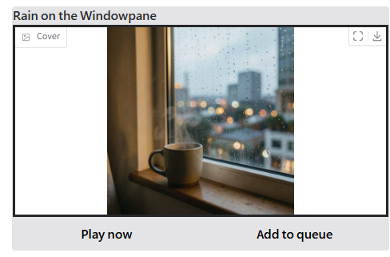
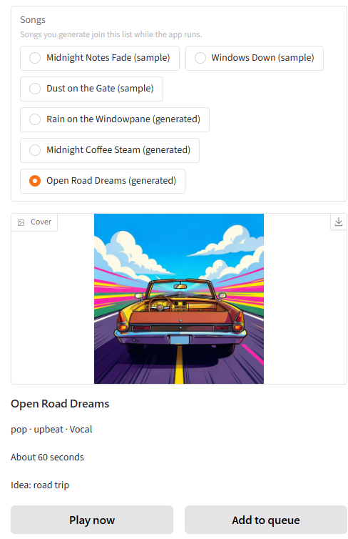
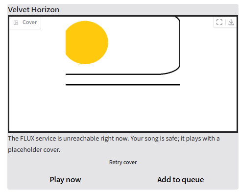
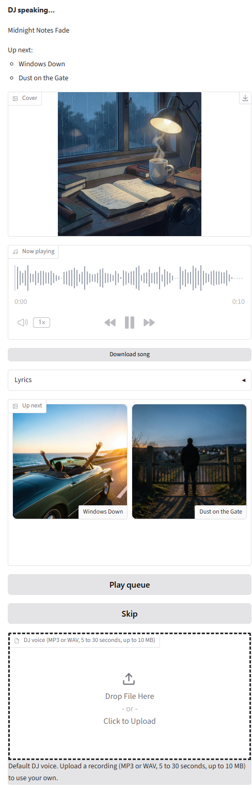
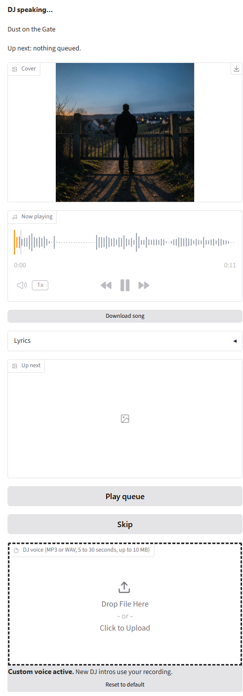

# AI Jukebox

> **AI assistants and newcomers:** start at [PROJECT.md §0](PROJECT.md#0-start-here). It has step-by-step paths for running the app with no coding, setting up to build it, and creating the repo.

> Work in progress for MBAX 6418 Assignment 3. The team plan lives in [PROJECT.md](PROJECT.md). This README becomes the graded documentation; its outline is PROJECT.md §11.

An app that generates custom songs (ACE-Step), matching cover art (FLUX), and plays a queue with AI DJ commentary (Qwen + Chatterbox) between tracks, using only the class services.

## For teammates: getting started
Full instructions with a macOS and a Windows column: PROJECT.md §16.1. Short version:

| | macOS (Terminal) | Windows (PowerShell) |
|---|---|---|
| 1. Setup | `python3 scripts/setup_dev.py` | `py scripts\setup_dev.py` |
| 2. Fill in `.env` | `open -e .env` | `notepad .env` |
| 3. Activate | `source .venv/bin/activate` | `.venv\Scripts\Activate.ps1` |
| 4. Check | `python scripts/doctor.py` | `python scripts\doctor.py` |
| 5. Work | `claude` → `/start-session <task key>` | `claude` → `/start-session <task key>` |

Never commit `.env`.

## Overview
AI Jukebox runs on your own computer and opens in your browser. It does three things:
- **Makes songs.** Pick a style, a mood, a length (10 to 120 seconds) and instrumental or vocal. A vocal song gets original lyrics written for it. A song usually takes about 10 seconds, a little longer for vocal songs or when the class servers are busy.
- **Paints a cover for every song,** from the song's style and mood. If the cover fails, the song is kept with a placeholder and **Retry cover** tries again.
- **Plays a queue with a DJ.** Before each song, the DJ normally speaks a short intro about it, in the default voice or one you upload. Three sample songs are included, so you can press **Play queue** and hear it before making anything.

All the AI work is done by four class services, and nothing else: Qwen3.6-35B-A3B for text, FLUX.2 klein 4B for covers, ACE-Step 1.5 XL Turbo for music, and Chatterbox Multilingual V3 for the DJ's voice. Your class key stays on your computer (see [The settings file](#the-settings-file-env)).



*The top of the app on Windows 11, running `rc2`: how to use it, the Generate tab, and the player.*

**Status.** The release candidate is `rc2`; the submitted version will be `v1.0`. It has been run on Windows 11 and on macOS; the results are under [Test results](#test-results).

## Requirements
- **A computer:** Windows 10 or 11, or macOS 13 or newer.
- **Python 3.11 or newer** (3.12 recommended). The steps below show how to install it.
- **Network access to the class servers.** A VPN or the campus network was not needed when tested from a
  home network.
- **The class credentials** in `class-endpoints.txt`, from the course materials (ask the instructors if you
  don't have it).
- **The app ZIP:** from the Canvas submission, or from the repository's **Tags** page on GitHub: open the
  newest tag (the final one is `v1.0`) and click **Source code (zip)**. There is no GitHub Release page.
- **A browser.** Browsers block sound until you click on the page, so start playback with **Play queue**.
- **Nothing else.** No ffmpeg, Docker, Node or paid services. The Python packages install by themselves from `requirements.txt` (every version is pinned) the first time you start the app.

## Setup
The launcher does the technical work: on the first start it creates your settings file and opens it for
you; on the next start it installs what the app needs, checks the class servers, and opens the app in your
browser, usually at **http://127.0.0.1:7860** (if that port is busy, the launcher shows the address it used).

### Windows
1. **Install Python** from **python.org/downloads** (3.12 recommended). On the installer's first screen,
   tick **Add python.exe to PATH**, then click **Install Now**. The installer can take several minutes.
2. **Unblock the ZIP before you extract it.** Right-click the downloaded ZIP, choose **Properties**, and at
   the bottom of the General tab tick **Unblock**, then click **OK** (no Unblock box means it's already
   unblocked). Without this, Windows' Smart App Control blocks `run.bat` ("Smart App Control blocked a file
   that may be unsafe"), with no option to run it anyway.
3. **Extract the ZIP:** right-click it, choose **Extract All…**, set the destination to `C:\jukebox`, and
   click **Extract**. Open the extracted folder until you see `run.bat` and `README.md`: that's the **app
   folder**. Don't put it inside OneDrive, and don't run anything from inside the ZIP.
4. **First start:** in the app folder, double-click **`run.bat`**. If Windows shows "Windows protected your
   PC", click **More info**, then **Run anyway**. The launcher creates a settings file called `.env`, opens
   it in Notepad, and waits: press any key or close its window.
5. **Fill in the settings:** change only the first 5 settings, `CLASS_API_KEY` and the four lines ending in
   `_BASE_URL`. The file comes with placeholders such as `your-class-api-key-here` and
   `http://CLASS_HOST:9001`, which look like real values but aren't. For each one, replace the whole
   value after the `=`, including `CLASS_HOST`, with the value from `class-endpoints.txt`, with no spaces
   or quotes. Leave the other lines as they are. Save, close Notepad,
   and keep the name `.env`. This file stays on your computer: never email it or upload it.
6. **Start the app:** double-click **`run.bat`** again. The first time, it installs what the app needs,
   which takes a few minutes. Then it checks the class servers and opens the app in your browser. Keep the
   black launcher window open while you use the app; **close that window to stop the app**.

### macOS
1. **Install Python** from **python.org/downloads** (3.12 recommended, the `.pkg` installer). The installer can take several minutes.
2. **Extract the ZIP:** double-click it in Downloads, then drag the folder it creates into your home folder
   (Finder > Go > Home). Open the folder until you see `run.sh` and `README.md`: that's the **app folder**.
   Don't put it inside iCloud Drive.
3. **First start:** open **Terminal**, type `bash ` (with a space after it), drag **`run.sh`** from the
   folder into the Terminal window, and press **Enter**. The launcher creates a settings file called `.env`,
   opens it in TextEdit, and stops.
4. **Fill in the settings:** change only the first 5 settings, `CLASS_API_KEY` and the four lines ending in
   `_BASE_URL`. The file comes with placeholders such as `your-class-api-key-here` and
   `http://CLASS_HOST:9001`, which look like real values but aren't. For each one, replace the whole
   value after the `=`, including `CLASS_HOST`, with the value from `class-endpoints.txt`, with no spaces
   or quotes. Leave the other lines as they are. Save and keep the
   name `.env`. Finder hides files
   whose names begin with a dot: press **Cmd+Shift+.** to see it. This file stays on your computer: never
   email it or upload it.
5. **Start the app:** run `bash run.sh` again the same way. The first time, it installs what the app needs,
   which takes a few minutes. Then it checks the class servers and opens the app in your browser. Keep the
   Terminal window open while you use the app; close it or press **Ctrl+C** to stop the app.

### The settings file (`.env`)
The launcher creates `.env` from `.env.example`. These are the settings. Only the first five need your values.

| Setting | What it's for | Port | Example (placeholder only) |
|---|---|---|---|
| `CLASS_API_KEY` | The class key, sent to the four class services | | `your-class-api-key-here` |
| `QWEN_BASE_URL` | Text: titles, lyrics, cover prompts, DJ scripts (Qwen3.6-35B-A3B) | 9001 | `http://CLASS_HOST:9001` |
| `FLUX_BASE_URL` | Cover art (FLUX.2 klein 4B) | 9006 | `http://CLASS_HOST:9006` |
| `ACESTEP_BASE_URL` | Music (ACE-Step 1.5 XL Turbo) | 9007 | `http://CLASS_HOST:9007` |
| `CHATTERBOX_BASE_URL` | DJ speech (Chatterbox Multilingual V3) | 9008 | `http://CLASS_HOST:9008` |
| `QWEN_MODEL`, `FLUX_MODEL`, `ACESTEP_MODEL`, `CHATTERBOX_MODEL` | The model names the services expect. Already filled in; leave them. | | |
| `QWEN_TIMEOUT_S`, `FLUX_TIMEOUT_S`, `ACESTEP_TIMEOUT_S`, `CHATTERBOX_TIMEOUT_S` | How long to wait for each service. Optional; leave them. | | |
| `APP_HOST`, `APP_PORT` | Not used yet: the app always listens on `127.0.0.1:7860`, or on `7861` if that port is busy. Leave them. | | |

Enter only `http://host:port`: if `class-endpoints.txt` shows a trailing `/v1`, leave it out. **Port 9000 is never used**: the launcher stops and names the setting if any address uses it, or if a service's address uses another service's port. To check your settings without showing them, run `python scripts/check_config.py`.

**Keeping the key safe.** `.env` is ignored by git, so it can't be committed, and the release ZIP check fails if one is inside. Only the app's server code reads the key (`jukebox/config.py`) and sends it to the class services; the page in your browser never receives it, and the app removes it from its logs. Never email `.env`, paste it into a chat or an issue, or put it in a screenshot. **If a key leaks** (committed, posted or emailed): get a replacement by following the class instructions, put the new value in `.env`, and remove the leaked copy from where it went. For a commit, that means purging it from the repository's history, not only deleting the file.

### If something goes wrong
| What you see | What to do |
|---|---|
| "Smart App Control blocked a file that may be unsafe" (Windows) | Delete the extracted folder, unblock the ZIP (Windows step 2), and extract it again. Don't use **Run as administrator**, and don't turn Smart App Control off: it can't be turned back on without reinstalling Windows. |
| "An Application Control policy has blocked this file" (Windows, while the app starts) | Delete the `.venv` folder in the app folder and start the launcher again; it reinstalls the tested versions. |
| "Python 3.11 or newer was not found" | Re-run the Python installer (Windows: tick **Add python.exe to PATH**), then open a new window and start the launcher again. |
| The launcher lists settings that still need fixing | Open `.env` (the launcher opens it for you), fix the named settings, save, and start the launcher again. |
| "The app is already running in another window" | It is: the launcher opens the running app in your browser instead of starting a second copy. |
| A service "rejected our credentials" | A value in `.env` is wrong. Copy it again from `class-endpoints.txt`, with no extra spaces, then restart the launcher. |
| A service "is unreachable right now" or "took too long" | The class servers may be busy, or your network may block them. Use **Retry** in the app, or try again later. |
| The browser says it "can't connect" | The launcher window must stay open while you use the app. Start the launcher again. |
| No sound | Click on the page first, then check your volume and output device. |

## Using the app
_TODO: playback controls (E)._ The DJ is under [The AI DJ](#the-ai-dj).

### Generate a song
Open the **Generate** tab. Each choice has a one-line hint under its name.



*The Generate tab after a vocal song (pop, upbeat, 60 s, idea "road trip"): the form, the status line, and the result card with its cover and lyrics.*

**An instrumental**
1. **Style:** pick a genre, for example **lo-fi hip hop**. You can add your own words under **Extra style tags** (instruments, an era, a feel), separated by commas.
2. **Mood:** pick how it should feel, for example **mellow**.
3. **Length (seconds):** drag the slider or type a number from **10 to 120**. The default is 60.
4. **Vocal or instrumental:** choose **Instrumental**.
5. **Song idea (optional):** what the song is about, for example *a rainy evening*. It shapes the title and the cover.
6. Click **Generate**. The button greys out, and the status line shows **Queued**, then names each stage and counts the seconds, for example "**Composing music…** · 4 s · usually about 10 s, longer when the class servers are busy". When it says **Added to your library**, the result card shows the title, and the cover a few seconds later.
7. **Play it.** When the song is ready, **Play now** and **Add to queue** on the result card turn on. **Play now** plays the song at once in the player on the right. **Add to queue** puts it at the end of the queue, without interrupting the song that's playing. If nothing is playing, press **Play queue** to start it.

**A vocal song**

Same steps, but choose **Vocal** in step 4. The first stage after **Queued** is **Writing lyrics…** instead of **Naming your track…**, and the result card also shows the lyrics, which the text model (Qwen) writes for each song. Vocal songs sound best at 30 seconds or more.

**Not sure what to make?** Click **Surprise me**, next to **Generate**. It fills the form with a random style, mood, length (30 to 90 seconds), vocal or instrumental, and song idea, and clears **Extra style tags**. Nothing is made yet: change anything you like, then click **Generate**. It's greyed out while a song is being made.

The vocal result card is in the screenshot above, and an instrumental one is under [Cover art](#cover-art).



*The player playing a vocal sample song, with the next song under **Up next**.*

**What to expect**
- **Wait:** about 5 to 10 seconds per song when the class servers are quiet. We measured 4.8 to 9.5 s in B5 (#32), 5.5 to 7 s in B6 (#36), and a reviewer saw 7 s. Most of it is the music model (ACE-Step, 4.4 to 8.4 s); the text model (Qwen) takes 0.4 to 1.5 s. The page says "usually about 10 s". It can take longer when many people use the class servers, and the status line keeps counting so you can see it hasn't frozen.
- **The cover** is painted after the song is saved, usually 2 to 3 s later. The card shows a placeholder and "Painting cover…" until it arrives. If the cover fails, the song is kept, and a **Retry cover** button appears.
- **Phrases that point at a real artist are removed** when the name starts with a capital letter. In **Extra style tags**, phrases like "in the style of …", "featuring …" or "…'s voice" with an artist's name show a note under the box ("Removed …"), and the song is generated without them. **Song idea** only removes "in the style of …" (or "in the vein / spirit / manner of …"), "sounds like …" and "à la …", because a song idea is a subject and may name a person. The app asks the models for original songs; see [Known issues](#known-issues) for what it can't prevent.
- **If something fails,** the status line says what went wrong in plain words, your choices stay filled in, and **Retry** appears when trying again can help (a slow or unreachable class server). If your settings are wrong, it says to fix them and restart.
- **Every song, samples included, is also listed in the Library tab.** Pick one to see its cover and details, then use the same **Play now** and **Add to queue** buttons. Generated songs stay there until you stop the app.
- **To make a song like one you have,** pick it in the Library and click **More like this**. It opens the **Generate** tab with the form filled in from that song (style, extra style tags, mood, length, vocal or instrumental, and song idea), and the status line names the song. Change anything you like, then click **Generate**. If the song's style or mood isn't in the lists, that choice stays as it was, and the status line says so. While a song is being made, it only shows a short notice and changes nothing.

**Tested on `rc1`** (Windows 11, 2026-10-27; full rows in [`docs/TEST_EVIDENCE.md`](docs/TEST_EVIDENCE.md)):

| Test | What we did | Result |
|---|---|---|
| TC-01 instrumental | lo-fi hip hop, mellow, 45 s | **Pass.** Added in 7 s, 0:45 long, no vocals |
| TC-02 vocal | pop, upbeat, 60 s, idea "road trip" | **Pass.** Added in 6 s, 10 lines of lyrics shown, all 10 sung |
| TC-03 songs kept across tabs | Both songs, then Library → Generate → Library, then play the older one | **Partial.** Both stayed in the Library and played. But after the queue had finished, **Play now** didn't play the song until the page was reloaded (bug #72, fixed after `rc2` in #95) |
| TC-F1 bad credentials | A wrong API key for one run | **Pass.** "The Qwen service rejected our credentials…", choices kept, no Retry; works again after restarting with the right key |
| TC-F2 a class server not answering | ACE-Step pointed at a port nothing listens on | **Pass.** "The ACE-Step service is unreachable right now…", **Retry** shown, choices kept |

### Cover art
- **Every song gets its own cover.** After a song is saved, Qwen writes an image prompt from the song's
  title, style, mood, theme and lyrics, and FLUX paints a square cover from it. The song is playable right
  away; the cover follows a few seconds later.
- **While it paints,** the result card shows the placeholder (a hand-drawn picture, not AI-generated) and
  **Painting cover…**, and swaps in the cover by itself when it's ready, without reloading the page.
- **If the cover fails** (for example a class server is busy), the card says what happened and adds
  "Your song is safe; it plays with a placeholder cover.", plus a **Retry cover** button. Retry paints a new
  cover for the same song. If no cover has started 60 seconds after the song, the card treats it as failed
  and offers Retry cover too.
- **In the player and the Library,** the cover shows next to **Now playing**, in **Up next**, and when you
  pick a song in the Library. The player reads the cover when a song starts, so a song you send to the
  player with **Play now** before its cover is ready keeps the placeholder there while it plays.
- **Covers stay with their song.** Each cover is stored and looked up by the song's id, never by its
  position in a list, so generating more songs or adding songs to the queue can't swap them.
- **What a cover is asked not to show:** every image prompt ends with "no text, no letters, no logos, no
  real people", and Qwen is told to show figures, if any, only from behind or far away. Nothing checks the
  finished image, so FLUX can still add small unreadable marks, for example on a book's pages; the sample
  covers were checked by eye (see [Sample songs](#sample-songs)).

Screenshots from `rc1` (Windows 11):



*A finished song's result card with its own cover.*



*A song's cover in the Library when you pick it.*



*A failed cover (here FLUX was unreachable): the song keeps the placeholder, with the note and **Retry cover**.*

### The AI DJ
Before each song in the queue, a DJ speaks a short intro about that song (30 to 45 words, about 10 seconds). The text model (Qwen) writes it from the song's title, style and mood, and the speech model (Chatterbox) says it. The next intro is made while the current song plays, so you usually don't wait for it.

**Hear the DJ in the default voice**
1. Click **Play queue**, under the player. With an empty queue, it fills the queue with the three sample songs.
2. The player says **DJ speaking…** with the song's title and what's **Up next**. When the intro ends, the song plays. The same happens before every song after it.
3. Under **Skip**, the **DJ voice** box says "Default DJ voice. Upload a recording (MP3 or WAV, 5 to 30 seconds, up to 10 MB) to use your own."



*The DJ speaking in the default voice. The **DJ voice** box at the bottom shows the default is in use.*

**Use your own voice**
1. Get a clear recording of one person talking, MP3 or WAV, **5 to 30 seconds** long and **up to 10 MB**. In our test, a recording from a MacBook's built-in microphone and one from an iPhone both sounded like the speaker (see [Design judgment](#limitation-we-investigated-custom-voice-quality-d)).
2. Drop the file on the **DJ voice** box, or click it and choose the file.
3. The box now says **Custom voice active.** "New DJ intros use your recording." and a **Reset to default** button appears.
4. Click **Play queue** (or add songs with **Add to queue**). Intros made from now on use your voice. The intro already made for the next song was in the old voice, so that song plays without an intro and your voice starts one song later (see [Known issues](#known-issues)).
5. To go back, click **Reset to default**. The app also forgets your voice when it stops: the next start uses the default voice.



*After a recording was uploaded: **Custom voice active** and **Reset to default**.*

**Where your recording goes.** The app keeps it in `runtime/uploads/` on your computer, which is not part of the repository or the submission ZIP. It sends the recording to the class speech service with each intro and doesn't save it there; the service keeps a small in-memory cache of recent recordings. Replacing or resetting the voice deletes the old recording.

**If a file is rejected.** The box says why and which voice is still in use, for example "That file is empty. Choose an MP3 or WAV recording. Still using the default voice." or "Clip must be between 5 and 30 seconds (this one is 300.0). Still using the default voice." The other reasons are a file that is too big, one that can't be read as audio, and one that isn't an MP3 or WAV (the upload box turns those away itself, with its own wording). In test TC-F3 (@afondale, Windows 11, recorded in [`docs/TEST_EVIDENCE.md`](docs/TEST_EVIDENCE.md)) the bad files were rejected as described, but the default voice wasn't heard afterwards, so that test is marked Partial.

**If the DJ can't speak.** The song still plays. The player shows "DJ unavailable for this track" and the next song carries on (test TC-F4, Chatterbox switched off for the run: the songs kept playing, with no intro).

## Sample songs

The app ships with three ready-to-play sample songs, so the player has something to play the moment the
app starts: press **Play queue**. Each has a title and its own cover.

| # | Title | Kind | Style | Mood | Length |
|---|---|---|---|---|---|
| 1 | Midnight Notes Fade | Instrumental | lo-fi hip hop, jazzy keys, vinyl crackle, soft drums | mellow | 60 s |
| 2 | Windows Down | Vocal | upbeat pop, summery, bright synths, catchy chorus, warm natural female vocals | joyful | 60 s |
| 3 | Dust on the Gate | Vocal | cinematic folk, acoustic guitar, strings, warm natural male vocals | melancholy | 60 s |

The files are in `samples/`: audio in `samples/audio/`, covers in `samples/covers/`, and the track details
in `samples/manifest.json`, which the app loads at startup.

### How the sample songs, lyrics, and covers were generated

- **Everything is AI-generated with the class services, through the app's own code.** One script,
  `scripts/generate_samples.py`, runs each sample through the same pipeline as the Generate tab:
  1. **Qwen3.6-35B-A3B** (port 9001) writes the title and, for the vocal songs, the lyrics.
  2. **ACE-Step 1.5 XL Turbo** (port 9007) makes the music from the style tags and lyrics.
  3. **Qwen** writes an image prompt from the song's title, style, mood, theme and lyrics, and
     **FLUX.2 klein 4B** (port 9006) paints the cover from it.
- **All lyrics and titles are written by Qwen.** No lyric, title, cover, or sound was written, drawn, or
  edited by a person. If a lyric had needed changing, the sample would have been regenerated, not edited.
- **Inputs:** the three style, mood and theme combinations in the table above (themes: late-night study
  session, road trip with friends, leaving a hometown), chosen by the team beforehand to show range (one
  instrumental, two vocal songs). The style tags name no artists or songs.
- **Seeds:** each sample's music and cover were sent a fixed seed (101, 202, 303), which is recorded in the
  log. In the team's early spike tests, the same seed and image prompt repeated the same cover, but the same
  seed did not reliably repeat the same audio, and Qwen gets no seed, so its words can differ each run. So
  the committed files are the record of what was generated, not something to regenerate.
- **Who and when:** generated by @felcervino on 2026-10-24, from commit `d7783d1` on the C6 branch: the
  code on `main` at `e925d7d` plus three small fixes to the script's messages and log formatting (the
  song and cover pipeline was unchanged). #51 later squash-merged those fixes together with the samples.
- **Human checks:** every song was listened to the end and every cover looked at, for fit with its style
  and mood and for text, logos, or faces. All passed. Sample 1's cover shows small unreadable
  handwriting-like marks on an open book; the people on the covers of samples 2 and 3 are seen only from
  behind.
- **Originality spot check:** for each vocal song, two distinctive lines were searched as exact phrases on
  the web: no match was found for any of the four. This is a limited check, not proof.
- **Full record:** [`samples/GENERATION_LOG.md`](samples/GENERATION_LOG.md) has, for each sample, the
  inputs, every service call with its model, port and timing, the Qwen title/lyrics prompt and the
  ACE-Step style tags exactly as the pipeline sent them, the full lyrics as generated, the exact FLUX
  prompt, and the human listening, cover and originality checks.

## Architecture
```
 Your browser  <---->  Gradio server on your computer (127.0.0.1:7860)
                               |
        jukebox/ui  ->  jukebox/services  ->  jukebox/clients  ---->  Qwen         :9001  (text)
        (the page)      (songs, art,          (the only code         FLUX         :9006  (covers)
                         dj, player)           that calls the         ACE-Step     :9007  (music)
                                               class servers)         Chatterbox   :9008  (DJ speech)
```

The app is one Python program. The page you see is built by `jukebox/ui`, which only calls the services. The services (`jukebox/services`: songs, art, dj, player) decide what to make and in what order. Only `jukebox/clients` talks to the class servers: one client per service, each with its own address and port. A check (`scripts/check_models.py`) fails if any other code makes a network call, if a feature uses a client that isn't its own (songs use Qwen and ACE-Step, covers use Qwen and FLUX, the DJ uses Qwen and Chatterbox, the player and the page use none), or if any other AI model, SDK or port appears.

**Why your key never reaches the browser.** Only `jukebox/config.py` reads the key from `.env`, and the clients add it to each request on the server side. The page is plain Gradio, so it receives text and files, never the key. The app listens only on `127.0.0.1`, so nobody else on your network can open it, and Gradio's public share links are switched off. Logs name the service and the address, never the key or the request headers.

**Where things are stored.**
| What | Where | In git or the ZIP? |
|---|---|---|
| The three sample songs, their covers, and how they were made | `samples/` (`audio/`, `covers/`, `manifest.json`, `GENERATION_LOG.md`) | Yes |
| Songs, covers and DJ clips you generate | `runtime/generated/` | No (`runtime/` is ignored by git and rejected by the ZIP check) |
| A voice recording you upload for the DJ | `runtime/uploads/`, one file with a random name. Gradio also keeps a temporary copy while the file is uploaded, under `runtime/uploads/gradio/`, and the app deletes that copy as soon as the upload has been saved or rejected. The saved file is deleted when you replace or reset the voice. Anything left over from an earlier run, for example if a delete failed, is deleted when the app starts on its usual port (7860). | No |
| The song list (the library and the queue) | The app's memory | No: it lasts until you stop the app. After a restart you have the three samples again, though the files you made stay in `runtime/generated/`. |
| Your settings and key | `.env` | No |

A song is saved before its cover is made, so a failed cover never loses the song. A failed DJ intro is skipped and the song plays. There is no fallback to any other model: on a failure the app shows a plain message and offers **Retry**.

## Test results
_TODO (E): from docs/TEST_EVIDENCE.md. Separate completed tests from unchecked claims._

## Known issues
_TODO: other lanes' entries._

**Song generation (B)**
- **The default singing voice can sound like a famous singer.** In testing, one indie-pop song with no artist named anywhere sounded very like a well-known pop singer. That's ACE-Step's own default voice; a style tag can't reliably steer it away from one person. The app screens the part it controls: phrases naming an artist that the user types (next item).
- **The artist screen only catches explicit forms.** In Extra style tags it removes "in the style (vein, spirit, manner) of / sounds like / à la *Name*", "inspired by / influenced by / similar to *Name*", "featuring / feat. / ft. / sung by / vocals by / cover of *Name*", "*Name*-style", "*Name*'s voice" and "like *Name*". Song idea removes only "in the style (vein, spirit, manner) of / sounds like / à la *Name*", so "inspired by *Name*", "featuring *Name*" or "*Name*'s voice" typed there stays. Not caught anywhere:
  - a bare name ("*Name* pop");
  - a name that doesn't start with a capital letter ("in the style of *name*", or a name that starts with a digit). Lowercase was left out on purpose: catching it also removed descriptions like "inspired by the sea";
  - a band named after a place or a genre: "pop in the style of Chicago" drops "in the style of" but keeps "Chicago", with no note;
  - "*Name* vibe", "*Name* type beat", "*Name*-ish", "*Name*-like", "a song by *Name*";
  - a band name with a comma ("Earth, Wind & Fire style" leaves "Earth");
  - a name that starts with two `$`: `pop, $$uicideboy$$ style` leaves a stray `$`.

  The last two keep the real names because the problem is in how those names are spelled.

  It can also remove a capitalized phrase that isn't an artist ("sounds like Heaven"), so the note says the removed text *may* point at an artist.

  It's pattern-based on purpose: a list of artist names could never be complete, and looser patterns kept removing everyday styles ("Golden Hour vibes", "Workout type beat"). The lyrics and title prompts also tell Qwen never to name or imitate a real artist.
- **The music model doesn't always sing every word.** Even with lyrics sized to the length, 60 s songs have dropped their 2-line outro, a few words, or one line of the chorus (see [Design judgment](#design-judgment)). The lyrics on the result card are what was sent, not a transcript.
- **One song at a time.** The Generate button runs one request at a time. A second browser tab's request waits silently until the first finishes. The app is meant for one person on their own computer.

**AI DJ (D)**
- **An intro can name the wrong song before it.** Each intro is written while the song before it plays, and the script may add a short transition from that song. If you press **Play now** on a different song first, the intro that comes next can still refer to the song that was playing when it was written.
- **A new DJ voice starts with the next intro.** A new voice applies only to intros made after the change. The intro already made for the next song was in the old voice and is dropped, so that song plays without an intro, and your voice speaks from the song after it.
- **A song can start before its intro is ready.** Intros are made in the background, and one takes about 4 to 5 seconds when the class servers are idle (measured: 3.75 to 4.94 s). If you press **Play queue** right after the page opens, or skip quickly, the song plays without an intro. If that intro then fails, nothing tells you.

## Design judgment

### Design choice: lyrics sized to what ACE-Step will sing (B)
**The choice.** The lyrics prompt asks Qwen for only as many lines as ACE-Step actually sings at the requested length (`plan_sections` in `jukebox/services/songs.py`):

| Length | Lyrics asked for |
|---|---|
| under 20 s | a 2-line verse |
| 20–29 s | 2-line verse and 2-line chorus |
| 30–39 s | 4-line verse and 4-line chorus |
| 40–74 s | verse, chorus and a 2-line outro (10 lines) |
| 75 s and up | verse, chorus, verse, chorus, outro (18 lines) |

**Why.** Our first plan scaled lyrics with length, "roughly 2 sections per 30 s" (PROJECT.md §8.1), so a 45–60 s song got 18 lines. ACE-Step doesn't speed up to fit more words: it sings about one verse and one chorus, then **skips whole sections from the middle**, so the song loses its story. In the B6 listening tests, one check during the C3 review, the shipped samples (C6) and the release-candidate test (TC-02 on `rc1`), each song was generated on the class servers and a teammate counted the lines actually sung against the lyrics sent:

| Song (test) | Length | Lines sent | Lines sung | What happened |
|---|---|---|---|---|
| Freedom Unlocked (B6) | 45 s | 18 | about 10 | second verse and chorus skipped |
| Neon Highways (B6) | 50 s | 18 | 8 | verse, half a chorus, outro |
| Chasing Sunsets (B6) | 60 s | 18 | 8 | verse, half a chorus, outro |
| sample_02 spec (C3 review, #33) | 60 s | 18 | all but lines 6–9 | the chorus cut after one line, then a jump into verse 2 |
| Freedom Bell (B6) | 45 s | **10** | **10** | all sung |
| Open Road (B6) | 60 s | **10** | 8 | verse and chorus sung; the 2-line outro dropped |
| Windows Down (sample_02, C6) | 60 s | **10** | 10 | every line sung, but "Together now" dropped from the chorus and the outro slurred |
| Dust on the Gate (sample_03, C6) | 60 s | **10** | 9 | one chorus line skipped |
| Miles of Sun (TC-02 on `rc1`) | 60 s | **10** | **10** | all sung |

With 18 lines, three of the four songs lost about 8 lines or more, and the fourth lost 4 lines from the middle. With 10 lines, no song lost more than 2 lines or a whole section from the middle: two were sung in full, one dropped its 2-line outro, one dropped a few words and slurred its outro, and one skipped a single chorus line (@gunnaroc counted the two C6 rows against the lyrics while reviewing #51, and the TC-02 row during the `rc1` test). So the fix greatly reduces what's lost, but doesn't make ACE-Step sing every word. Two songs weren't counted line by line: an earlier 60 s song with 18 lines (B5, *Static on the Road*) sounded clean to the listener, and a 10-line punk song (B6, *Debt Degree*) ran cleanly. Too few lines may have its own problem: in B2, a 60 s song with only a verse and a chorus stopped abruptly at about 58 s. The spike's likely cause was too few lyrics for the length (not tested on its own), so the 40–74 s plan adds a short outro. Because of the sample_02 spec result, we asked lane C to generate the shipped samples only after this fix; their generation log (`samples/GENERATION_LOG.md`) shows both vocal samples were sent the 10-line plan.

**Trade-off.** Songs under 75 s have one verse and one chorus, not two. Songs of 75 s and up still get 18 lines, and the 120 s maximum hasn't been listened to line by line yet.

### Limitation we investigated: custom voice quality (D)
**What we saw first.** The D1 spike was run by @dilloncsmart on Windows 11 on 2026-10-16. The custom-voice clips made from a team member's recording (about 11.6 s, recorded on a laptop microphone) came out muffled and didn't sound much like the speaker, while the default voice was clear but flatter than a real radio DJ. Voice cloning copies the quality of its reference, so the spike's note was that a cleaner recording should help, and it listed that re-test as a follow-up.

**What we did.** On 2026-10-30, on macOS in Chrome, running `main` at `6382b97` (the code is the same as `rc2`; the commits since then are docs only), @mlip3191 first heard a DJ intro in the default voice. Then @mlip3191 read the same sentence twice, once into the Mac's built-in microphone and once into an iPhone. Both recordings were converted to WAV with `afconvert` (a tool that comes with macOS) and uploaded through the **DJ voice** box, one at a time. After each upload we played the sample queue and @mlip3191 listened to a DJ intro.

**What we heard.** The default voice was clear, sounded like a DJ, and matched its song. Both custom voices gave an intro that sounded like the speaker and was clearly different from the default voice. The built-in microphone recording sounded good, the iPhone one sounded clean, and the two sounded the same.

**What we learned.** We did not see the muffled result again, and we heard no gain from the iPhone recording over the laptop one. This is not a like-for-like re-test of the spike: the person running it (@dilloncsmart then, @mlip3191 now), the machine, the OS (Windows 11 then, macOS now) and the recording all differ, and the speaker probably does too. We also compared two good recordings and never tried a deliberately poor one, so we haven't shown that recording quality doesn't matter. We don't know why the spike's recording sounded muffled, and we didn't test whether its format (a 44.1 kHz stereo WAV, or an MP3) caused it, or try it again, so the cause is still open. If a custom voice sounds wrong, click **Reset to default** and try another recording.

**How far to trust this.** One speaker, one listener, one intro heard per voice, not blind, with different songs in each comparison, on macOS only. These are ears, not measurements. The spike's result is in [`docs/spikes/D1-chatterbox.md`](docs/spikes/D1-chatterbox.md).

**Related.** A new voice applies from the next intro, so the first song after a change has no intro, and skipping within a few seconds of starting a song can also skip its intro (see [Known issues](#known-issues)).

## Documentation verification
Two people who didn't write a section followed it literally and reported what didn't match (PROJECT.md §11). Findings are listed by tester and OS.

**Windows 11, in Chrome: @gunnaroc (B10), 2026-11-01.** There were two passes.
- **Pass 1** followed Cover art, The AI DJ and Sample songs, on `main` at `c915595`.
- **Pass 2** followed Requirements, Setup (Windows), the Overview and the troubleshooting table, on this README at `278d201`. It started from the `rc2` ZIP downloaded from **Tags**, unblocked and extracted to a new `C:\jukebox`. `run.bat` was run twice, with the settings filled in between.

*What matched.* Cover art, the AI DJ (default voice, a voice upload, **Reset** and a rejected file) and Sample songs, including `samples/manifest.json` and `GENERATION_LOG.md`. The Windows steps (Unblock, Extract All, the first `run.bat` creating the settings file and opening it in Notepad). The second `run.bat`: the first install took about 3 minutes, all four services showed PASS (9001, 9006, 9007, 9008), and the app opened. Closing the black window stopped the app, and the browser then couldn't connect, as the troubleshooting table says. The Overview matches the screen. Every message the troubleshooting table quotes exists in the launcher or the app, and the 7861 fallback matches `jukebox/ui/launch.py`.

*What didn't match, and what we did.*
1. **The settings step.** The placeholders (`http://CLASS_HOST:9001`) look like real addresses, so the tester thought the settings were already filled in. The step now names the placeholders and says to replace the whole value after the `=`, including `CLASS_HOST`. Fixed.
2. **The Overview's song time** said 5 to 10 seconds. A 60 s vocal song took 11 s, and the app's own hint says "usually about 10 s". The Overview now says "usually about 10 seconds". Fixed.
3. **Where Gradio's copy of an uploaded voice goes.** This README said it stays until the next start. The code deletes it as soon as the upload is saved or rejected, so the README was wrong. Fixed.
4. **Known issues** listed the Play now bug (#72) after it was fixed. Removed.
5. **`.env.example`**: its first line says "copy to `.env`" after the launcher has already made the copy, and it points to PROJECT.md section numbers that mean nothing to a reader. Not fixed yet.

*Not checked.* macOS (D9, below). Installing Python from scratch. The "Windows protected your PC" and Smart App Control prompts (neither appeared). The "already running in another window" row. Architecture, Safeguards and AI use were read against the code but not run. The three fixes above were made after pass 2, and nobody has followed the changed text since.

**macOS: @mlip3191 (D9).** _TODO: follow the sections you didn't write on a Mac, and list what matched and what didn't._

## Safeguards
The assignment's safeguards are in [`docs/STARTER_PROMPT.md`](docs/STARTER_PROMPT.md), word for word. This is how each one is enforced, and by what.

| Safeguard | What we do | Enforced by |
|---|---|---|
| **Credentials stay out of GitHub, the ZIP, the browser, logs and docs** | The key lives only in `.env`. Examples and docs use placeholders (`.env.example`). The browser never receives the key, and logs scrub it. | `.gitignore` (`.env`, `.env.*`); `scripts/scan_secrets.py`, which fails on a committed or zipped env file, on key-like strings, and on any value from your own `.env` found in a file, and runs in `/check`, in the pre-push gate and in CI; `jukebox/config.py`, where the key is a secret value that is never printed; log scrubbing in `jukebox/clients/base.py`; a guard hook that stops Claude Code from reading, printing or staging `.env` |
| **No uploads or voice recordings in GitHub or the ZIP** | An uploaded voice is saved only in `runtime/uploads/` under a random name. Gradio's temporary copy of the upload is deleted as soon as the voice is saved or rejected. The saved file is deleted when you replace or reset the voice, and left-over recordings are deleted when the app starts. It is sent to the voice service with each intro, never saved there as a named voice. | `.gitignore` (`runtime/`, `*.zip`); `scan_secrets.py` fails on anything under `runtime/` and on audio outside `samples/audio/`, in the repo and in a downloaded ZIP (`--zip`); only the one folder is ever written to for uploads (`jukebox/services/dj.py`) |
| **No third-party music, lyrics, cover art or voice samples** | The three sample songs, their lyrics and their covers were all made through the app's own Qwen, FLUX and ACE-Step clients, and `samples/GENERATION_LOG.md` records how. The prompts ask for original work and never an artist; phrases that name an artist in your style text are removed before they reach the models. | The sample list and log, reviewed in pull requests; the audio-location rule in `scan_secrets.py`; the prompts in `jukebox/prompts/` |
| **Only the four class models; never port 9000** | Qwen (9001), FLUX (9006), ACE-Step (9007) and Chatterbox (9008) each do one job. A failure shows a message and offers **Retry**, never a different model. | `scripts/check_models.py` with `scripts/model_policy.json` (fails on other AI libraries, hosted services, a network call outside `jukebox/clients/`, or a feature using the wrong client), in `/check` and in CI on Linux (every pull request and every push to `main`); `jukebox/config.py` and `scripts/check_config.py`, which refuse a port-9000 address or a service on another service's port; `scan_secrets.py`, which flags port 9000 in app code |
| **Every change is checked before it merges** | One task per branch, never a commit on `main`; the pre-push gate runs lint, format, the secret scan, the models check, the config check and the whole pytest suite; commits must be written by the person pushing them; someone other than the author approves, and the owner of the changed files merges. | `.githooks/pre-push` and `scripts/prepush.py`; `scripts/check_authors.py`; `.github/CODEOWNERS`; a Claude Code guard hook that blocks commits and pushes to `main`, force pushes and skipped checks |

**What we have and haven't checked.** The secret scan passes on the repository and on the `rc2` ZIP (GitHub's download of the tag), and the models check passes on every pull request. The full inspection of the ZIP, the browser's network tab, the logs and the screenshots (test TC-11), and the request log showing only the four services (TC-15), are part of the full test run, which isn't finished yet: see [Test results](#test-results).

## How we used AI and checked its work
**What we used.** The team's coding agent was Claude Code, set up with team rules in [`CLAUDE.md`](CLAUDE.md) and shared commands (`/start-session`, `/check`, `/finish-session`, `/review-pr`, `/log-test`). The exception is Adam Fondale, who used Grok. Every pull request has an "AI assistance" note that says which assistant was used and who checked the work. The assignment's starter prompt, word for word, and our additions to it are in [`docs/STARTER_PROMPT.md`](docs/STARTER_PROMPT.md); the additions were added early in the build (C0, #16). The AI models inside the app are a separate matter: they are the four class services only (see [Safeguards](#safeguards)).

**How we checked it.**
1. One task per branch. Code changes must come with test changes, and the full test suite runs before every push (the `pre-push` gate, once it's set up) and again in CI. Our rule was to write the test cases first.
2. In the Claude Code workflow, a separate review agent reads the whole change before a push, every blocking finding is fixed, and then a person gives a clear yes. Every pull request, whichever assistant was used, also goes through CI and a teammate's review (next step).
3. A teammate other than the author reviews and approves the pull request, and the owner of the changed files merges it. Nobody merges their own unreviewed work. GitHub requires one approval and a passing check before anything merges to `main`.
4. Audio, covers and the DJ voice need a human to look or listen, so a result is logged in `docs/TEST_EVIDENCE.md` only if someone ran it and says what they saw. What was not checked is written in the row.

**Mistakes we caught.** Each of these was found by testing, CI or review, and fixed:
- **Retry cover kept a dead address (#74, fixed in #77).** After the FLUX address was corrected in the settings file, **Retry cover** still used the old one until a restart. The failure test TC-F5 found it, and the same test passed after the fix (see both TC-F5 rows in `docs/TEST_EVIDENCE.md`).
- **Retry cover was hard to see (#66, fixed in #78).** On a failed cover the button rendered as small plain text and didn't look clickable. It was filed as an issue and became a full-size button, like **Play now**.
- **CI caught a Windows-only test failure (#73).** The Windows CI job was red on every `main` run from 10/24 to 10/27 because one test ran WSL's `bash` instead of Git Bash. The problem was in the test, and #73 fixed it.
- **Our local check and CI disagreed (#26, fixed in #31).** The pre-push gate ran `python -m pytest` while CI ran `pytest`, so the two could give different results. #31 makes the gate run the tests the way CI does.
- **A review agent corrected a draft of this README (#85).** A draft of the DJ section said the three sample songs were "already in the queue" (**Play queue** fills an empty queue), listed test details that nobody had confirmed, and compared a new voice test with an earlier one without saying that the speaker, machine and operating system had changed. All three were fixed before the change was pushed.

## Team & contributions
Counts are from GitHub on 2026-10-30. "Authored" includes open and closed-unmerged pull requests; "reviewed" counts other people's pull requests that the person reviewed with a formal GitHub review (approval, requested changes or a review comment); plain comments on a pull request are not counted. Each count links to the GitHub list behind it.

| Member | Role | What they built | PRs authored | PRs reviewed |
|---|---|---|---|---|
| Michael Lippert ([@mlip3191](https://github.com/mlip3191)), macOS | A: Platform & Release (release lead); D: AI DJ & Launchers from #65 | Project plan, scaffold and guardrails; the settings loader, shared HTTP client and error model; the track library and job store; the pre-push gate; wiring Generate and Library to the player; the DJ voice upload and the prefetched DJ intros; the release candidates and their ZIP checks; ran the reliability tests (TC-12, TC-14) | [29](https://github.com/mlip3191/ai_assignment3/pulls?q=is%3Apr+author%3Amlip3191) | [45](https://github.com/mlip3191/ai_assignment3/pulls?q=is%3Apr+reviewed-by%3Amlip3191+-author%3Amlip3191) |
| Gunnar O'Connor ([@gunnaroc](https://github.com/gunnaroc)) | B: Song Generation | The Qwen and ACE-Step clients, the title and lyrics prompts, the song pipeline, the artist-name screen, the Generate tab, and the song-generation README | [13](https://github.com/mlip3191/ai_assignment3/pulls?q=is%3Apr+author%3Agunnaroc) | [23](https://github.com/mlip3191/ai_assignment3/pulls?q=is%3Apr+reviewed-by%3Agunnaroc+-author%3Agunnaroc) |
| Felipe ([@felcervino](https://github.com/felcervino)) | C: Cover Art, Samples & Evidence | The FLUX client, the cover prompt, the placeholder, the cover service and **Retry cover**, the three sample songs and how they were made, the screenshots, the Setup and cover-art README sections, and **Surprise me** and **More like this** | [24](https://github.com/mlip3191/ai_assignment3/pulls?q=is%3Apr+author%3Afelcervino) | [25](https://github.com/mlip3191/ai_assignment3/pulls?q=is%3Apr+reviewed-by%3Afelcervino+-author%3Afelcervino) |
| Adam Fondale ([@afondale](https://github.com/afondale)), Windows | E: Player, UX & QA | The player spike, the app shell, the queue, the player panel, and the failure-case evidence | [9](https://github.com/mlip3191/ai_assignment3/pulls?q=is%3Apr+author%3Aafondale) | [27](https://github.com/mlip3191/ai_assignment3/pulls?q=is%3Apr+reviewed-by%3Aafondale+-author%3Aafondale) |
| Dillon Smart ([@dilloncsmart](https://github.com/dilloncsmart)) | D: AI DJ & Launchers, until it was reassigned to Michael (#65) | The Chatterbox spike and client, the DJ commentary prompt and service, the `run.sh` and `run.bat` launchers, and the full-size **Retry cover** button | [7](https://github.com/mlip3191/ai_assignment3/pulls?q=is%3Apr+author%3Adilloncsmart) | [12](https://github.com/mlip3191/ai_assignment3/pulls?q=is%3Apr+reviewed-by%3Adilloncsmart+-author%3Adilloncsmart) |

The test runs recorded in `docs/TEST_EVIDENCE.md` were done by the people named in each row.
